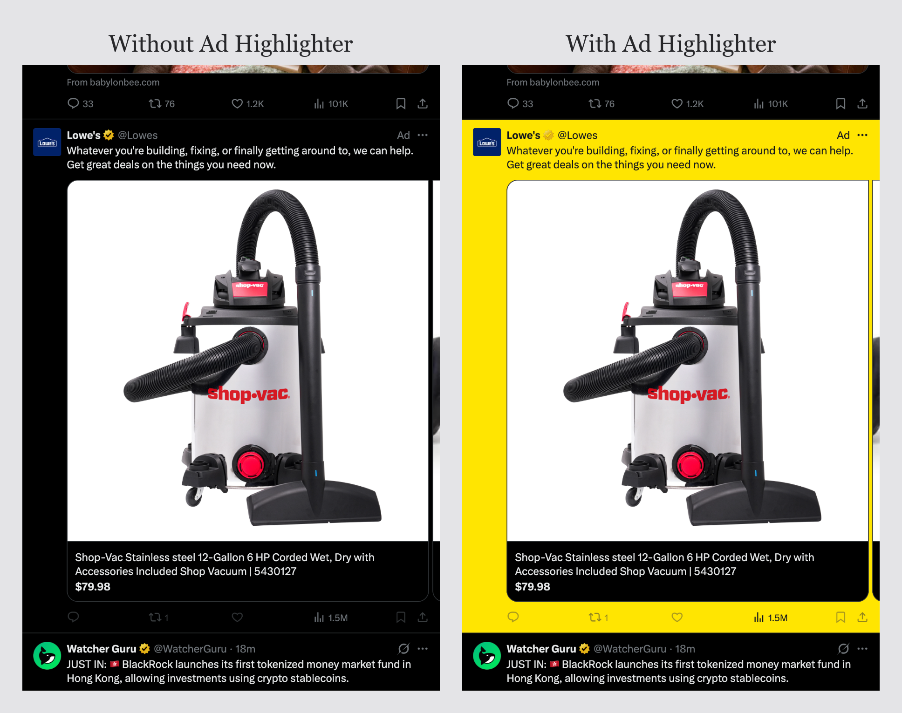

# Ad Highlighter

A Chrome extension that paints ads bright yellow, so you can tell at a glance what is an ad and what isn't.



**Works on:** X (x.com) and Facebook (facebook.com)

## What it does

On a supported site, Ad Highlighter finds the posts that the site labels as ads and paints each one bright yellow with dark text. Every other post stays exactly as it was. Inside an ad, wide parts with their own background, such as the bar under a link, turn yellow too. Photos, videos, captions on them, and smaller parts such as a "Shop now" button keep their own colors, so they stay readable. On Facebook, it also paints the "Sponsored" box at the side of the page.

That is all it does. There are no settings.

## Privacy

Ad Highlighter never phones home and stores nothing about you.

- It makes no network requests of any kind.
- It saves nothing: no settings, no history, no cookies, no data.
- It asks Chrome for no permissions beyond access to the sites it supports, and runs nowhere else.
- On those sites, it reads the page as it loads and as new posts appear, finds the ads, and colors them. Nothing else.

The code is short, so you can check this yourself in [`src/`](src/).

## Performance

It has no noticeable effect on speed. One frame on a 60 Hz screen lasts 16.7 ms. An average scan takes a small part of that, and the slowest scan took less than half of it:

| Measured on a live feed | X | Facebook |
|---|---|---|
| Scans a second while you scroll | about 9 | about 9 |
| Time for one scan, on average | 0.8 ms | 1.4 ms |
| Time for one scan, at most | 3 ms | 7 ms |
| Share of the browser's time while you scroll | less than 1% | about 1% |
| Share of the browser's time while the page sits still | less than 0.2% | less than 0.1% |

Measured in November 2026. The Facebook numbers come from scrolling much faster than people read. The yellow coloring adds no cost that could be measured when the browser redraws the page.

## Install

Ad Highlighter is not in the Chrome Web Store, so you load it from a folder.

1. Download this repository: click **Code**, then **Download ZIP**, and unzip it. Or clone it with git.
2. Open `chrome://extensions` in Chrome.
3. Turn on **Developer mode** (top right).
4. Click **Load unpacked** and choose the folder.
5. Reload any open x.com or facebook.com tab.

To update, get the new version the same way, click the reload button on Ad Highlighter's card in `chrome://extensions`, and reload the site's tabs.

It also works in Brave, and it should work in other browsers built on Chrome, such as Edge and Arc.

## How it finds ads on X

X marks each ad with the word "Ad" on the same line as the author's name (older ads say "Promoted"), and ads show no timestamp. A post is highlighted only when it has that label and at least one of these two checks agrees:

1. The label is on the same line as the author's name.
2. The post has no timestamp of its own.

If X changes one of these, the other check still finds ads. Each check fails safe: if a change on X stops a check from working, that check stops finding ads instead of marking normal posts.

The label counts only when the word stands alone and a reader can see it. Inside a post's text, a name, a link, a quoted post, a link card, a photo or a video, it never counts.

The extension reads X's English labels. If your X is in another language, add the word X shows on ads to `AD_LABELS` in [`src/sites/x.js`](src/sites/x.js).

## How it finds ads on Facebook

Facebook works hard to stop scripts from reading its ad label. Today the word "Ad" under an advertiser's name is an SVG picture, which points through a chain of other SVGs to a hidden copy of the word. Facebook has also shown the label in other forms, and it often tries new page markup on some users before others. So Ad Highlighter has three ways to find the label ("Ad" or "Sponsored"):

1. An SVG that draws the label.
2. A hidden label that screen readers read.
3. Plain text.

A post is an ad when any of these ways finds the label on the author's line or the line just under it, where Facebook shows it. On ads about social issues or politics, that line reads "Sponsored · Paid for by …", which counts too. A hidden copy of the label never counts, and neither does the same word anywhere else, such as in the post's text, a video or a shared post. A fourth way finds the box at the side of the page whose heading is "Sponsored".

Links in an ad's text lose Facebook's blue on yellow, so Ad Highlighter underlines them.

The extension reads Facebook's English labels. If your Facebook is in another language, add the words Facebook shows on ads to `AD_LABELS` in [`src/sites/facebook.js`](src/sites/facebook.js).

## Adding a site

Each site is one small file in `src/sites/`. To add one:

1. Copy `src/sites/x.js` to a new file, such as `src/sites/example.js`.
2. In it, list the site's ways of showing ads. Each way has `posts()`, which returns the posts on the page, and `isAd(post)`, which returns true for an ad. A post is an ad when any way finds it. Sites often show ads in more than one way at once, for example while they test new markup, so add a way for each one you find. `src/sites/facebook.js` shows a site with several ways, and the helpers in `src/core.js` cover the common cases.
3. Add an entry for the site to `content_scripts` in `manifest.json`. List `src/core.js` before the new file, and include `src/highlight.css`.
4. Add tests for the site to `test/`, like `test/x.test.js` or `test/facebook.test.js`. The shared code already has its own tests in `test/core.test.js`.

A site can also have its own CSS file for small changes to the look, like `src/sites/x.css`. List it after `src/highlight.css` in the site's entry.

To run the tests, you need Node.js:

```sh
npm install
npx playwright install chromium
npm test
```

## License

MIT. See [LICENSE](LICENSE).
